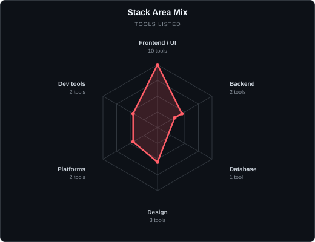
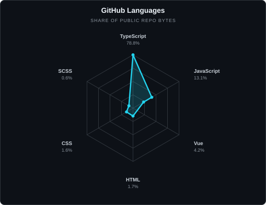
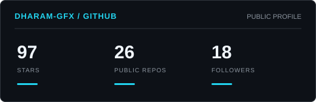
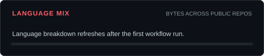

<picture>
  <source media="(prefers-color-scheme: dark)" srcset="assets/banner-dark.svg">
  <source media="(prefers-color-scheme: light)" srcset="assets/banner-light.svg">
  
</picture>

 

 

---

## About Me

I'm Dharmendra, a full-stack developer from Bihar, India. I enjoy working across frontend and backend, exploring new tools, and building useful things for the web.

- Focused on frontend and backend development
- Currently exploring new technologies and improving my craft
- I like turning ideas into practical, polished projects

---

## My Perfect Stack

 

---

## Signals

<table>
<tr>
<td width="50%" align="center" valign="middle">
<picture>
  <source media="(prefers-color-scheme: dark)" srcset="assets/radar-stack-dark.svg">
  <source media="(prefers-color-scheme: light)" srcset="assets/radar-stack-light.svg">
  
</picture>
</td>
<td width="50%" align="center" valign="middle">
<picture>
  <source media="(prefers-color-scheme: dark)" srcset="assets/radar-languages-dark.svg">
  <source media="(prefers-color-scheme: light)" srcset="assets/radar-languages-light.svg">
  
</picture>
</td>
</tr>
</table>

---

## Numbers Matter? Ohh Yes.

<picture>
  <source media="(prefers-color-scheme: dark)" srcset="assets/card-stats-dark.svg">
  <source media="(prefers-color-scheme: light)" srcset="assets/card-stats-light.svg">
  
</picture>

 

<picture>
  <source media="(prefers-color-scheme: dark)" srcset="assets/card-languages-dark.svg">
  <source media="(prefers-color-scheme: light)" srcset="assets/card-languages-light.svg">
  
</picture>

---

  Thanks for stopping by. Keep building.

